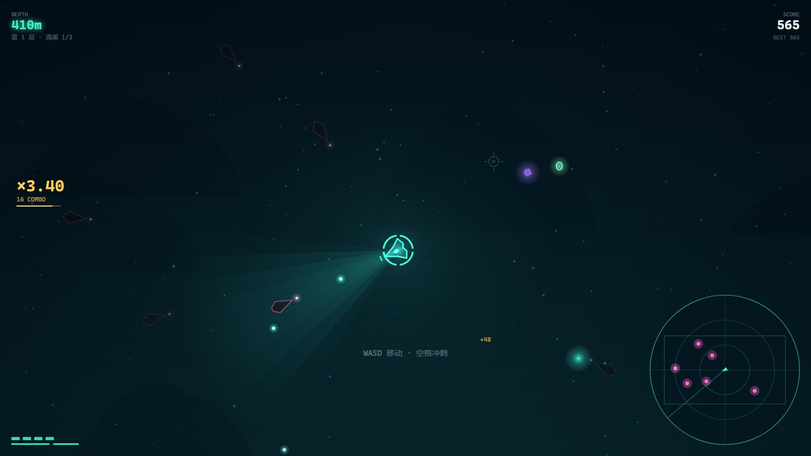
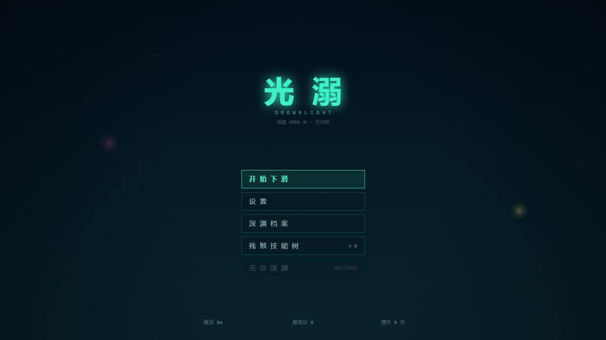
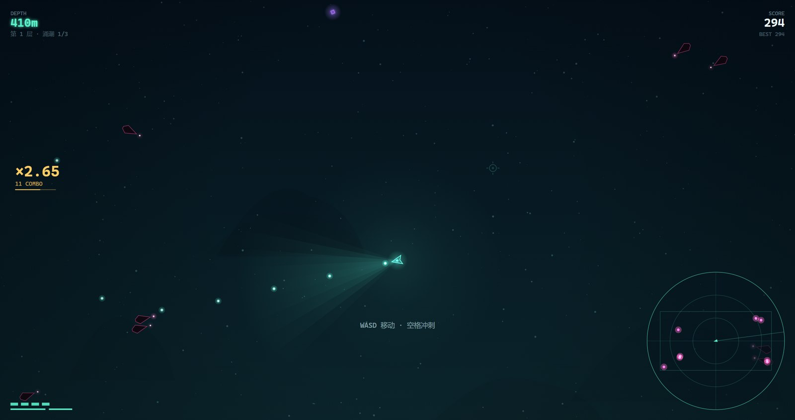
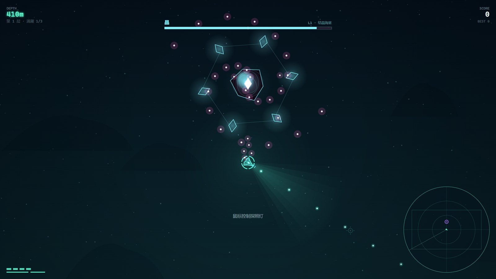
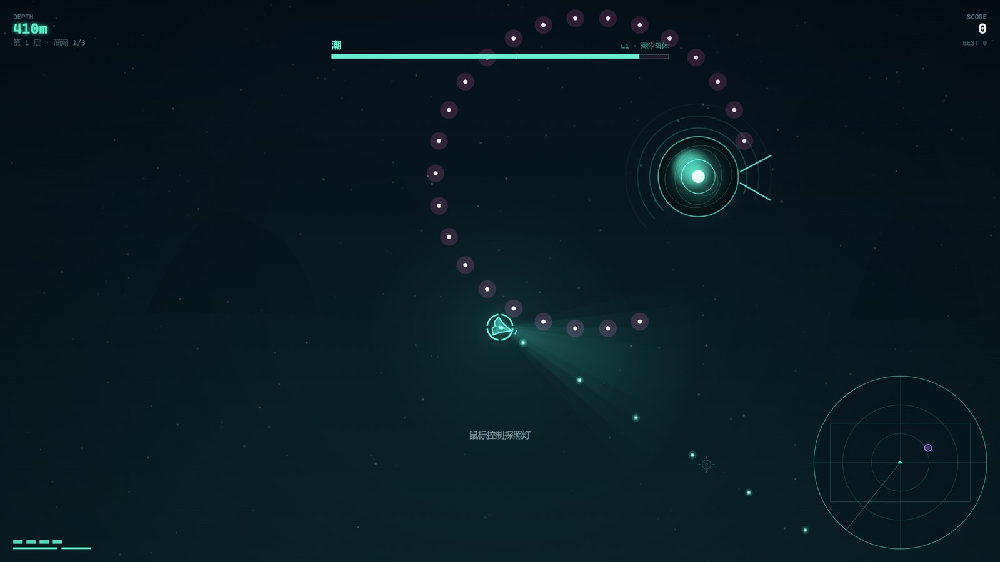
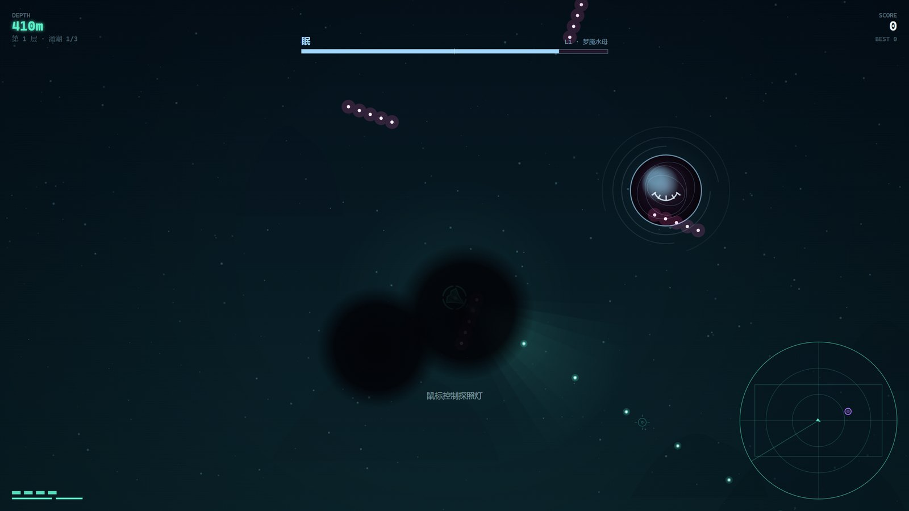
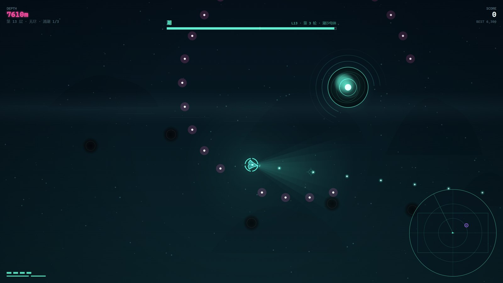

# 光溺 · DROWNLIGHT

**A deep-sea sonar shooter that draws itself.** No image files, no font files, no audio files —
every creature, light cone, particle and sound is generated at runtime with Canvas 2D and WebAudio.
Ships as a single 1.35 MB Windows executable.




## What it is

A 15–18 minute roguelite run into the lightless zone 4000 m down. Your lamp is the only thing
that can see, and it also gives you away.

- **Sonar instead of sight** — enemies only exist visually inside your lamp cone, within 260 px,
  or for 1.5 s after a sonar sweep. Their wind-ups are always visible, though.
- **12 bosses, 6 per run** — each run draws 6 distinct bosses from the pool and sorts them by
  threat, so every run has a different line-up but a difficulty curve that still climbs.
- **47 cards** with prerequisites and archetype weighting, plus a permanent 6-arm skill tree.
- **Endless mode** — after clearing layer 6, keep diving; every 6 layers rerolls the boss roster
  and scales health up.
- **120 Hz fixed-step logic** with an auto-scaling render resolution (60/120/144/240 fps targets).

## Play it

| | |
|---|---|
| **Windows exe** (recommended) | Download `Drownlight-v0.1.0-win64.exe` from [Releases](../../releases) and run it. No install, no runtime to add — it uses the WebView2 that ships with Windows. |
| **In a browser** | Open `index.html` in Chrome / Edge. Works straight off the filesystem (`file://`); no build step, no server. Fullscreen and save location differ from the exe. |
| **From source** | `powershell -ExecutionPolicy Bypass -File build\build.ps1` — needs only the .NET Framework 4.8 compiler that ships with Windows. |

> **SmartScreen:** the exe is unsigned, so the first launch after downloading will show
> “Windows protected your PC”. Click **More info → Run anyway**. This is expected, not a virus.

- Windows 10 1903+ / 11 (x64). Windows 11 and any Windows 10 with Edge already has WebView2.
- Progress is stored in `%LOCALAPPDATA%\Drownlight`. Delete that folder to reset.
- Run one instance at a time; two copies would share the same user-data folder.

## Controls

| Action | Keyboard / mouse |
|---|---|
| Move | `WASD` / arrow keys |
| Aim (lamp direction) | mouse position (pointer is locked in-game) |
| Fire | automatic |
| Dash | `Space` / `Shift` |
| Active sonar ping | `Q` |
| Inventory (pauses) | `B` / `Tab` |
| Fullscreen | `F` / `F11` |
| Pause | `Esc` / `P` |
| Mute | `M` |
| Console | `~` / `F1` |
| Pick a card | `1` `2` `3` or click |

Every key except `F11` and the debug keys can be rebound in **Settings → Keys**.
Dashing while standing still is a backdash.

## Screenshots

| | |
|---|---|
|  |  |
| Title screen — everything is vector | A run in progress; sonar contacts sit on the disc at the right |
|  |  |
| 晶 · crystal anemone with orbiting shards | 潮 · ring walls with a single gap |
|  |  |
| 眠 · dream fog, closed eye | Endless, layer 13 — “round 3” roster |

## Under the hood

- **One global namespace, classic `<script>` tags** — deliberately no ES modules, because they are
  blocked by CORS under `file://` and the game must open by double-click.
- **Every tunable lives in `js/data.js` (`T`)** — no magic numbers anywhere else.
- **Batching** — the light cone is pre-rendered into a single sprite, particles and snow are merged
  into a few `fill` calls by colour × alpha bucket, bullets share one path.
- **WebAudio synthesis** — four-layer music, scene cross-fades, rate-limited SFX; zero audio files.
- **Host channel** — the page asks the C#/WebView2 shell for borderless fullscreen over
  `postMessage`, so `Esc` (pause) never drops you out of fullscreen.
- **Headless checks** — `?selftest=1`, `?bosstest=1&frames=N`, `?bench=1` write results into
  `body[data-test]` / `body[data-bench]`; `--probe` dumps them to JSON so CI can assert on them.

---

# 中文文档

深海无光带里的单人下潜射击。原生 Canvas 2D + WebAudio，**零素材、零外部依赖**，
发行形态是单文件 Windows 客户端 `光溺.exe`（约 1.35 MB，内嵌全部游戏文件）。

## 三条核心规则

1. **看不见敌人，但永远看得见威胁。** 敌人本体只在灯锥内、身边 260px 内、或被声呐扫过时显形；
   但它们的攻击蓄力是强光，全屏可见。
2. **声呐给的是旧消息。** 每 2.4 秒一圈声呐扫过，扫到谁就在右下角声呐盘上留一个会淡出的光点，
   被扫到的敌人显形 1.5 秒。
3. **被打中就断连击。** 分数全在连击倍率里，躲得比打得好更重要。

## 构筑

- **47 张卡**：武器改造（射击 / 近战）、辅助系统、被动强化、传说四类。
- **前置解锁**：会改动某个流派的卡，必须先拿到它的本体才会出现在抽卡池里。例如
  长刃 / 双刃 / 刃舞 需要先有 **光刃**，锐利需要先有 **暴击** —— 不会出现「拿到就废」的卡。
- **近战流派**：光刃（身前 100° 弧形横扫，画面上常驻一条判定弧，刃口扫过时留白痕）、长刃、双刃、刃舞，
  配合环刃与灼环。
- **流派权重**：每张卡带流派标签（射击 / 近战 / 光域 / 声呐 / 生存 / 机动 / 暴击 / 爆破）。
  手上同标签的卡越多，抽卡时同类卡权重越高（最高约 ×3.9），一条路走深了会越走越顺。
- **每次抽卡都有一次免费重抽**，技能树「备用方案 / 全频段 / 听海」再往上叠，按钮上显示 `×N`。
- **技能树 6 条臂 × 8 个节点**：光学、声呐、战斗、结构、动力、采集；全部点亮约需 2.3 万残骸数据，
  随时可免费重置。
- **局内背包**：按 `B` 或 `Tab` 打开，游戏自动暂停，左侧是已选卡牌与等级，右侧是当前完整属性面板。

## 图鉴

标题界面 → 深渊档案。分 **卡牌 / 生物 / Boss** 三页：

- **卡牌**：抽卡时出现过的卡才会点亮；未解锁只显示剪影与「？」
- **生物**：真正进入视野（灯锥、近距弱光或声呐显形）才算见过
- **Boss**：进入战斗即解锁

选中的条目会在右侧显示完整说明、数值（生物）或等级效果（卡牌），并统计这张卡被选过多少次。
旧存档里选过的卡会自动补进图鉴。

## 小怪与 Boss

| 小怪 | 行为 |
|---|---|
| 灯笼鱼 | 忽明忽暗，亮起时加速扑上来 |
| 水母 | 悬停射击，单发瞄准或环形散射 |
| 乌贼 | 蓄力后直线冲锋 |
| 管虫 | 固定不动，周期隐藏并吐弹 |
| 斧头鱼 | 绕圈高速游弋 |
| 鮟鱇 | 精英，吸入 + 假诱饵 |
| 磷虾群 | 成群高速漂移，贴脸即伤 |
| 帷幕 | 合拢时减伤 55%，展开时露出三眼并三连射 |

十二个 Boss 组成 Boss 池。**每一局只随机抽 6 个**，按威胁等级从低到高排在第 1~6 层；
无尽模式每打完一轮（6 层）重新抽一批，已打过的优先避开：

| Boss | 威胁 | 机制 |
|---|---|---|
| 荧 · 巨型水母 | 1 | 环形弹幕 + 触手横扫 |
| 锈 · 寄生沉船 | 1 | 亮腹预警 → 直线冲撞 → 撞墙硬直，留下会追人的腐蚀粘液 |
| 墨 · 大王乌贼 | 2 | 墨云遮视野 + 八腕横扫 |
| 潮 · 潮汐母体 | 2 | 闭环浪墙只留一道缺口，缺口每波转向，同时刷磷虾群 |
| 灯 · 鮟鱇王 | 3 | 假光点诱导 + 吸入 + 咬合 |
| 眠 · 梦魇水母 | 3 | 催眠雾吞视野 + 贴身减速场 + 四臂慢弹 + 幻影 |
| 镜 · 镜像体 | 3 | 三个锚点只有一个是真的本体，假身也会放冷枪，只有本体吃伤害 |
| 群 · 管虫珊瑚 | 4 | 四角炮茧持续压制，拆光才有硬直 |
| 鲸 · 骸骨鲸 | 4 | 横穿战场，被撞掉血；只有颅骨上转动的眼睛吃满伤害，骨面几乎白打 |
| 晶 · 结晶海葵 | 5 | 六枚晶簇公转并各自开火，本体持续吐螺旋；晶簇全碎则停摆、受伤 ×1.5 |
| 渊 · 热泉巨蠕虫 | 5 | 点燃热泉 + 半血分裂，缩回壳里时无敌 |
| 光溺 · 终末体 | 6 | 深渊挤压 + 感官剥夺 + 双层环弹 |

血量按层折算，而不是按 Boss 固定：`T.boss.rankHp` 给出第 1~6 层的基准血量，
每个 Boss 用自己的 `hp / rankHp[rank]` 折算。800 血的「荧」排到第 6 层就是 3800 血。

## 两种模式

- **深海潜航**：固定 6 层，每层 3 波涌潮 + 1 个 Boss，打完第 6 层通关。
- **无尽深渊**：通关后解锁。层数不封顶，每 6 层算一轮：**每轮重新抽一批 6 个 Boss**（优先避开刚打过的），
  血量按轮次 ×1.55、轮内每层再 ×1.055 上涨。结算页会列出本局遭遇过的 Boss。

## 文件结构

```
index.html             页面骨架、canvas、脚本加载顺序（双击即可试玩）
css/style.css
js/data.js             第 0 节：所有可调数值 + 敌型 / 卡牌 / Boss / 技能树数据
js/core.js             循环、输入、全屏与指针锁定、存档、全局状态
js/audio.js            音效合成 + 分层音乐 + 场景混音
js/entities.js         玩家 / 敌人 / 子弹 / 粒子 / 掉落
js/systems.js          属性重算、涌潮与层、计分、卡牌、Boss、环境
js/render.js           背景 / 光域 / 实体 / HUD / 声呐盘 / 准星
js/ui.js               状态机与所有界面
js/console.js          内置控制台
js/main.js             启动与调度
docs/光溺-设计规格书.md   完整设计文档（26 章，含每次迭代的原因）
docs/shots/            截图
build/                 C# + WebView2 外壳、构建脚本、图标生成
test.ps1               无头验收脚本
```

**调平衡只改 `js/data.js` 里的 `T`**，其余文件不应出现魔法数字。

## 重新编译 exe

改完 `js/` 之后，运行：

```
powershell -ExecutionPolicy Bypass -File build\build.ps1
```

用的是 Windows 自带的 .NET Framework 4.8 编译器，不需要装任何东西。
`build\refs\` 里是 WebView2 的托管库与原生 loader（来自 NuGet 包 `Microsoft.Web.WebView2`，
见 `THIRD-PARTY-NOTICES.md`），编译时按需内嵌进 exe。

图标是程序画出来的，改了绘制参数就重新生成一次：

```
python build\make_icon.py
```

它会输出 `build\icon.ico`（16/24/32/48/64/128/256 七个尺寸）与 `build\icon-preview.png`。
exe 的文件图标由 `/win32icon` 嵌入；**窗口图标**（任务栏、Alt-Tab、任务管理器）在 `OnHandleCreated`
里从内嵌资源取出 32×32 与 16×16 两枚 HICON 分别设置，所以两边始终一致。

exe 的版本资源写在 `build\Drownlight.cs` 的 assembly 特性里（`0.1.0.0`），改版本时和
`CHANGELOG.md` / git tag 一起改。

## 测试

```
powershell -ExecutionPolicy Bypass -File test.ps1              # 测打包好的 exe
powershell -ExecutionPolicy Bypass -File test.ps1 -Dev         # 测磁盘上的 js\
powershell -ExecutionPolicy Bypass -File test.ps1 -Frames 900  # 更长的 Boss 扫测
```

会跑 `?selftest=1`（结算入账 / 幂等 / 混音 / 画质）、`?bosstest=1`（12 个 Boss 各 N 帧 +
普通与无尽两条流程 + 换批）、`?bench=1`（满场帧耗时），全部通过退出码为 0。
脚本总是使用临时 profile，不会碰你的真实存档。

## 客户端通道

页面和宿主之间只有一条 `postMessage` 通道，全屏和退出都走它，不依赖浏览器 API：

| 方向 | 消息 | 作用 |
|---|---|---|
| 页面 → 宿主 | `fs:1` / `fs:0` | 请求进入 / 退出无边框全屏 |
| 页面 → 宿主 | `quit` | 关闭窗口、退出进程 |
| 宿主 → 页面 | `DL.fs.setFromHost(on)` | `F11` 改窗口状态后回同步页面 |

## 调试

这些是给开发者的口子，不是 bug：作弊键、无敌、给卡都不隐藏。

**内置控制台**：按 `~`（F1 也行）开关。打开时会吃掉键盘输入，人物不会乱走；再按 `~` 或 `Esc` 关闭。

```
help                命令列表
stats               开关左上角状态栏
god [0|1]           无敌
layer <1-99>        跳层
boss <1-6|id>       打本局名单里的第 n 个，或按 id 点将（boss whale）
bosses              列出 12 个 Boss 与本局名单
endless [0|1]       切换无尽模式
card <id> [lv]      给一张卡
spawn <type> [n]    生成敌人
kill                清场
give <n>            残骸 +n
fps <60|120|144|240>
scale <0.5-1>       手动缩放
quit                退出
```

运行时还有 `F2`（下一层）、`F3`（强制选卡）、`F4`（无敌）、`F6`（清场）四个调试键。

### 启动参数（用 `--query` 传给 exe）

| 参数 | 作用 |
|---|---|
| `?auto=1` | 跳过标题，直接开始 |
| `?sim=N` | 同步推进 N 个逻辑帧后停住（做确定性截图） |
| `?diag=1` | 把运行状态写进 `body[data-diag]` |
| `?god=1` | 无敌 |
| `?autopick=1` | 选卡自动选第一张 |
| `?layer=N` | 直接跳到第 N 层（无尽层数也支持） |
| `?layerboss=N` | 直接开第 N 层的 Boss（会触发换批与无尽缩放） |
| `?boss=N` | 打本局名单里的第 N 个 Boss |
| `?boss=<id>` | 直接打指定 Boss（`?boss=whale`，id 见 `bosses` 命令） |
| `?screen=tree\|settings\|codex\|summary\|cards` | 直接打开某个界面 |
| `?intro=1` | 直接播放开场投放 |
| `?selftest=1` | 跑结算/幂等/混音/画质自检，结果写进 `body[data-test]` |
| `?bosstest=1&frames=N` | 12 个 Boss 各跑 N 帧，查崩溃 / 弹幕失控 / 无尽换批，结果写进 `body[data-test]` |
| `?bench=1` | 造一个满场弹幕场景，测单帧渲染耗时，结果写进 `body[data-bench]` |

无头截图：

```
.\光溺.exe --selftest shot.png --query "?auto=1&sim=600"
```

把页面状态落盘（验证用）：

```
.\光溺.exe --probe state.json --probejs "JSON.stringify({s:DL.G.screen})" --probewait 2500
```

`--probejs` 里**不能有空格**（宿主按空格切参数），要写紧凑表达式或改成分号串联。

## 已知取舍

- 涌潮由「固定配额」改成「按时长 + 同屏上限」，因为按配额算一局只有 20 秒，撑不到设计的 45~75 秒。
- 「群」的炮茧改为「本体始终可受伤，炮茧存活时减伤 20%」，避免打不到炮茧时软锁。
- 数值以 `data.js` 为准，规格书里的表格是设计意图，实现时按手感微调过。
- exe 未签名；`index.html` 走浏览器时没有无边框全屏通道，全屏行为与 exe 不同。

## 性能与画质

逻辑跑 **120Hz 定步长**，渲染独立跑 rAF。渲染做了批处理：灯锥整锥烘成一张贴图（一帧一次 `drawImage`，
原来是九次渐变填充）、粒子与海雪按「颜色 × 透明度」合并成少数几次 `fill`、子弹合并路径。

**设置 → 帧率目标** 可选 60 / 120 / 144 / 240：

- 目标越高，像素预算越紧（240 帧上限 230 万像素，144 帧 310 万）
- 实际帧率低于目标的 92% 就自动降内部分辨率（240 帧时最低到 0.5 倍），稳定后再升回去
- 低于 95% 时进入低画质：省掉敌方诱饵灯之类的小光晕

实测（2560×1440，RX 7800 XT）：

| 帧率目标 | 实际 | 峰值帧时长 | 内部分辨率 |
|---|---|---|---|
| 120 | 174~215 fps | 5.8 ms | 2560×1440 |
| 240 | 240 fps | 4.3 ms | 2022×1137 |

## 许可

代码与文档以 **MIT** 发布，见 `LICENSE`。第三方组件见 `THIRD-PARTY-NOTICES.md`
（只有 WebView2 SDK，游戏本体没有任何第三方素材）。
